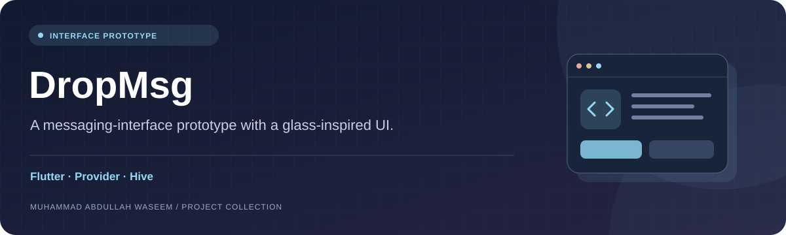

<p align="center"></p>

<p align="center"><a href="#project-guide">Project guide</a> · <a href="https://github.com/abdullahwaseem-dev/Drop_Msg/tree/main">Browse source</a> · <a href="https://github.com/abdullahwaseem-dev">Developer profile</a></p>

<a id="project-guide"></a>

# DropMsg — Flutter · Provider · Hive

DropMsg is a Flutter messaging UI prototype with animated onboarding, phone/OTP screens, profile setup, and a tabbed home interface. The default entry point uses Provider and Hive; the inspected authentication provider simulates registration and sign-in.

## Highlights

- Glass-inspired surfaces and animated splash/onboarding screens.
- Phone verification and profile-setup interfaces.
- Theme, connectivity, and local-storage helpers.

## Run locally

Use a Flutter SDK whose bundled Dart version satisfies `^3.9.2`, as declared in [pubspec.yaml](pubspec.yaml). Configure the platform toolchain for your intended device.

```sh
git clone https://github.com/abdullahwaseem-dev/Drop_Msg.git
cd Drop_Msg
flutter pub get
flutter run
```

## Source map

- [lib/main.dart](lib/main.dart)
- [lib/shared/providers/auth_provider.dart](lib/shared/providers/auth_provider.dart)
- [lib/shared/services/storage_service.dart](lib/shared/services/storage_service.dart)
- [DEVELOPMENT.md](DEVELOPMENT.md)

## Current scope

This is not a complete messaging service. Real authentication, message delivery, calls, and cryptographic guarantees require implementation and verification. The previous README's claims about quantum encryption, 4K group calling, and full platform support were not supported by the inspected code.

## Verification

```sh
flutter analyze
flutter test
```

These commands describe how to check the project; they were not run as part of the documentation refresh. Platform directories and declared dependencies do not prove that every target builds successfully.


---

## Author and project links

Built by [Muhammad Abdullah Waseem](https://github.com/abdullahwaseem-dev). [Portfolio](https://abdullah-waseem.vercel.app/) · [LinkedIn](https://www.linkedin.com/in/abdullahwaseem-dev/) · [Project enquiries](mailto:maw112266@gmail.com)

For a bug report, include the affected version, environment, reproduction steps, and expected behaviour in [Issues](https://github.com/abdullahwaseem-dev/Drop_Msg/issues). If the project is useful to you, a star is appreciated.

**Reuse:** no root license file was found during this review. Public visibility alone does not grant permission to reuse the code; contact the author for terms.

